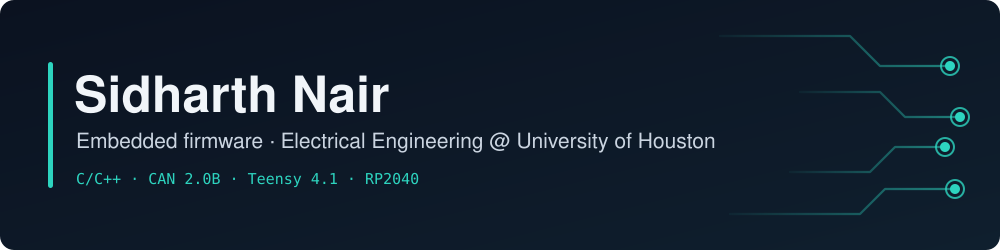

  

  
  
  

I'm a BSEE student at the University of Houston (GPA 3.93, expected graduation May 2028) who writes embedded firmware in C/C++, from rover fault handling over CAN to small Pico builds that drive real displays, sensors and buzzers.

**Looking for Summer 2027 internships** in embedded, hardware, or controls (Houston or remote).

## Skills

**Protocols & peripherals:** CAN 2.0B · I2C · PWM · ADC · GPIO

## Featured work

### [URC Rover Firmware](https://github.com/schradivarius/URC-MCU-Jetson-Comm-Protocol)
`C++` `CAN 2.0B` `Teensy 4.1` `Jetson`

Firmware team for a University Rover Challenge rover. My work is fault handling on the Teensy:

- Separate fault states for command-link loss and Jetson heartbeat loss, so autonomy keeps running through planned line-of-sight dropouts
- Heartbeat timeout and command-age checks on the 500 kbps CAN bus that drop stale drive commands and put the rover in a defined safe state
- Invalid-packet rejection, tested by injecting corrupted CAN frames
- Priority-ordered 11-bit message IDs so drive commands win arbitration over telemetry

### [PC Temperature Monitor](https://github.com/SNair-R/PC-Temp-Monitor)
`C` `Python` `Raspberry Pi Pico W` `I2C`

Live CPU/GPU temperature and usage on a 128x32 SSD1306 OLED, with overheat warnings. A Python host script streams stats over USB serial; the Pico parses them in C and draws them with a custom bitmap font.

### [Pomodoro Timer](https://github.com/SNair-R/Pomodoro-Timer)
`C` `Raspberry Pi Pico W` `I2C` `ADC` `PWM`

Standalone study timer with a 16x2 I2C LCD, potentiometer time selection, a debounced button and a PWM buzzer. Non-blocking millisecond timing keeps the UI responsive through a 4-cycle study/break session.

### Wafer Inspection *(in progress)*
`Python` `Computer vision`

Undergraduate research at Spark Up Research with a 3-person team building an automated wafer-inspection system. I'm developing the AI defect-detection model.
